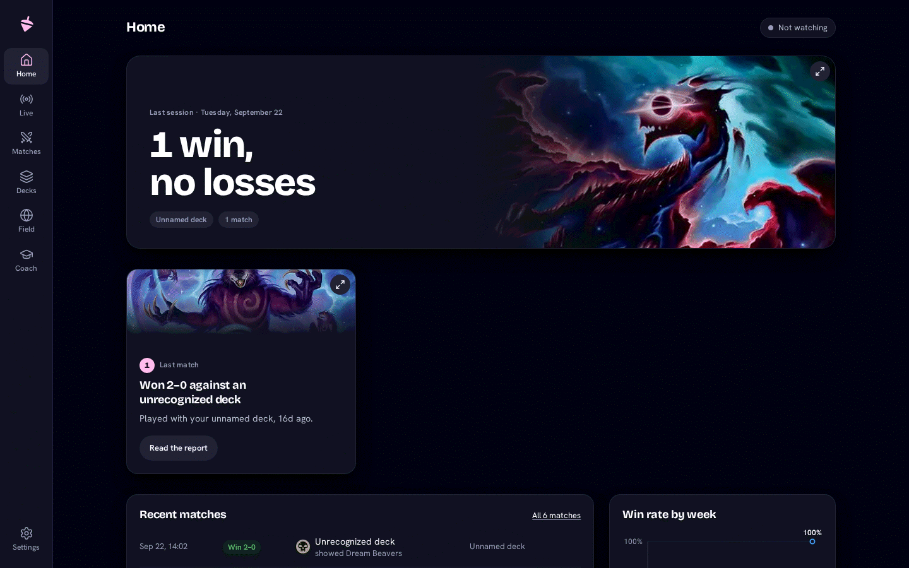
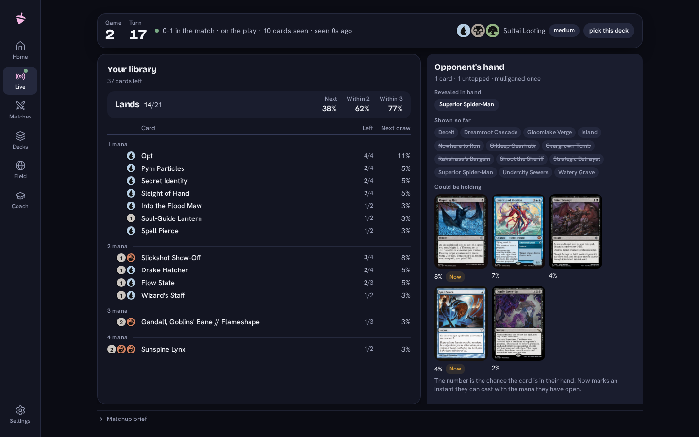
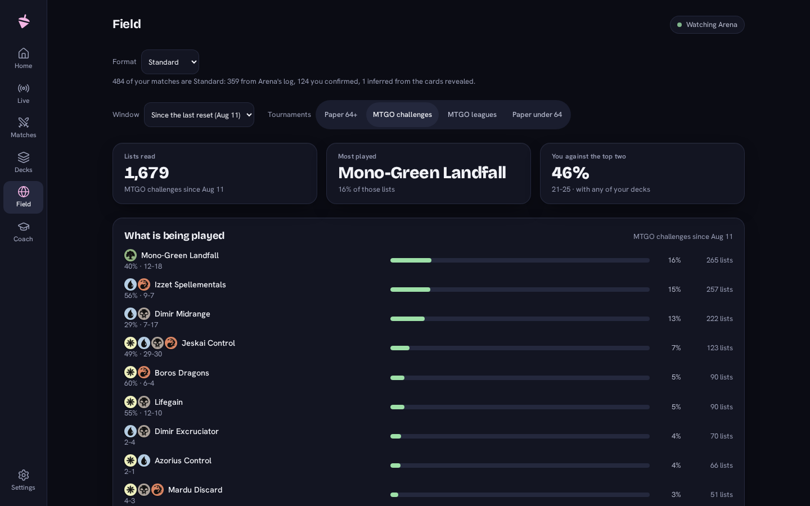

  

<h1 align="center">Sensei Top</h1>

  Free, fully local match analytics for Magic: The Gathering Arena and Magic Online.

  
  
  

  

Sensei Top reads the logs Arena and Magic Online already write on your
computer and turns them into a dashboard: every match and game, turn by
turn, your record with each deck and against each archetype, and what the
real tournament metagame looks like next to it.

- **Your matches stay on your computer.** No account, no upload; the
  dashboard runs on your own machine and answers nobody else. The one
  exception is a report you ask to generate with your own key, which
  sends that match to the model you configured.
- **Free, with no account.** The tracker is free now and later, and
  nothing free asks you to sign up. The [Microsoft Store](https://apps.microsoft.com/detail/9NZ5GQMCG1ZN) build of
  the same app is free now and priced later, and an optional paid tier is
  planned after that; the [roadmap](ROADMAP.md) says what each one is.
- **Read-only towards both clients.** It reads their log files and never
  writes to anything Arena or Magic Online owns.
- **Nothing to configure for Arena.** It finds Arena's log on its own,
  including on Linux through Steam, Lutris, Heroic, Bottles or Wine.
- **Written advice on your terms.** Deck guides, matchup briefs and
  coaching reports come as a prompt you paste into an assistant you
  already use, or from your own Claude key if you set one.

**Em português do Brasil.** O dashboard inteiro, do primeiro clique ao
relatório do treinador, lê em português do Brasil: escolha o idioma na
primeira abertura ou em Configurações. Nomes de cards, decks e arquétipos
ficam como o jogo os escreve, e os prompts que você copia continuam em
inglês: são texto para o modelo, não para você.

## Features

- **Home**: the last session, three things worth a look, and the win rate by week.
- **Live** (Arena): the match in progress, with a keep guide, a read of the
  opponent's likely hand, your remaining library and a sideboard plan between games.
- **Matches**: every match, with a report and a turn-by-turn replay of each game.
- **Decks**: each deck's record over every version, its matchups, and a
  guide that sets your list against the field.
- **Field**: the metagame from real Magic Online and paper tournament results.
- **Coach**: a dated report across every deck, each one measured against the last.

  

  

## Download

Sensei Top runs on Windows 10 and 11 (64-bit) and on 64-bit Linux. Get the
Windows installer or the Linux AppImage from [senseitop.com](https://senseitop.com)
or the [releases page](https://github.com/sensei-top/sensei-top/releases);
[INSTALL.md](INSTALL.md) has the steps for each system. On Windows, the
same app is also on the [Microsoft Store](https://apps.microsoft.com/detail/9NZ5GQMCG1ZN), free.

The one thing to change in Arena: turn on **Detailed Logs (Plugin
Support)** under Options → Account, then restart it.

## Get started

1. Install and open Sensei Top.
2. Follow the first-run setup: it finds Arena's log, asks where Magic
   Online keeps its game logs if you play there, and downloads card data.
3. Play. Matches appear as they finish; closing the window keeps the app
   recording from the system tray.

## Documentation

The [help pages](https://senseitop.com/help/), in English and Portuguese,
cover installing, the first run, Magic Online, troubleshooting and sending
a problem report. The [user guide](docs/user/README.md) is the reference
behind them: running from source, the command line, every page of the
dashboard, written guides and backups.

## Build from source

You need Python 3.12 or newer with [uv](https://docs.astral.sh/uv/), and
Node with [pnpm](https://pnpm.io/).

    uv sync
    cd web && pnpm install && pnpm start

The dashboard opens at http://127.0.0.1:8000. [Getting
started](docs/user/getting-started.md) has the rest. Before changing code,
read [CONTRIBUTING.md](CONTRIBUTING.md) and [AGENTS.md](AGENTS.md).

## How it's built

Sensei Top is developed with heavy use of generative AI. Most of its code,
tests and documentation are written by Claude, Anthropic's models (Opus and
Sonnet) working through Claude Code, and most commits Claude wrote carry a
`Co-Authored-By: Claude` line. The maintainer decides what gets built and
how it should behave, writes the plan each change follows, and reads the
diff of every merge: closely where a mistake would cost the most, not every
line.

Each change is checked before it is merged:

- **A second review.** A separate Claude reviewer checks each step of a
  plan against the rules in [AGENTS.md](AGENTS.md) and runs the tests
  itself.
- **Tests against real logs.** The project's rule is that every rule that
  reads a game log has a test against an anonymized capture of a real Arena
  or Magic Online log, with expectations read from that capture rather than
  copied from the code's output.
- **The full suite on every pull request.** Linting and the Python and
  dashboard tests run in [CI](.github/workflows/ci.yml) on each pull
  request to `develop` and `main`.
- **A privacy scan** runs before every commit and push, from the
  repository's own [git hooks](scripts/git-hooks/), so no player name,
  account ID or local path reaches it.
- **Real games.** Nothing is released before the maintainer has run it
  against their own Arena and Magic Online games, and release builds are
  tried by a small group of testers on Windows and a Steam Deck.

This is about how the app is made. The app itself never sends anything to
a model unless you set a Claude key of your own and press a button that
says it will use it.

## Contributing and support

A log-format fix that arrives with the log lines that broke it is the most
useful contribution there is; [CONTRIBUTING.md](CONTRIBUTING.md) says why
and how. Questions, ideas and votes on what comes next go to
[Discussions](https://github.com/sensei-top/sensei-top/discussions), and
the plan is in [ROADMAP.md](ROADMAP.md). To report a vulnerability, read
[SECURITY.md](SECURITY.md).

If Sensei Top earns a place in your routine, donations keep it maintained:
the links are on the project page.

## Licence

Copyright (C) 2026 The Sensei Top authors ([AUTHORS](AUTHORS)).

Sensei Top is free software under the GNU Affero General Public License,
version 3. It comes with no warranty; the full text is in
[LICENSE](LICENSE). The name and logo are not covered by that licence: see
[TRADEMARK.md](TRADEMARK.md).

## Credits

Sensei Top is unofficial Fan Content permitted under the Fan Content Policy. Not approved/endorsed by Wizards. Portions of the materials used are property of Wizards of the Coast. ©Wizards of the Coast LLC.

Card data and images come from [Scryfall](https://scryfall.com), tournament
results from [MTG_decklistcache](https://github.com/fbettega/MTG_decklistcache) and
[TopDeck.gg](https://topdeck.gg), and archetype definitions from
[MTGOFormatData](https://github.com/Badaro/MTGOFormatData). None of them
produces or endorses Sensei Top. What is taken from each, and on what terms, is
in [docs/attribution.md](docs/attribution.md).
